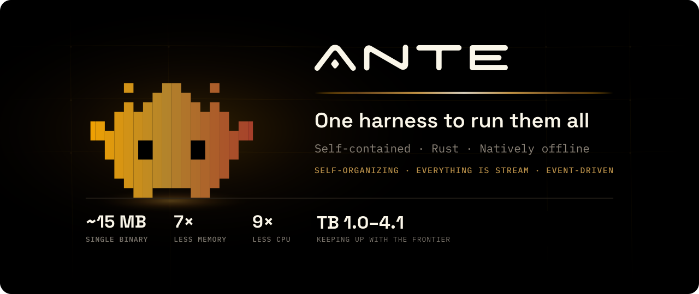
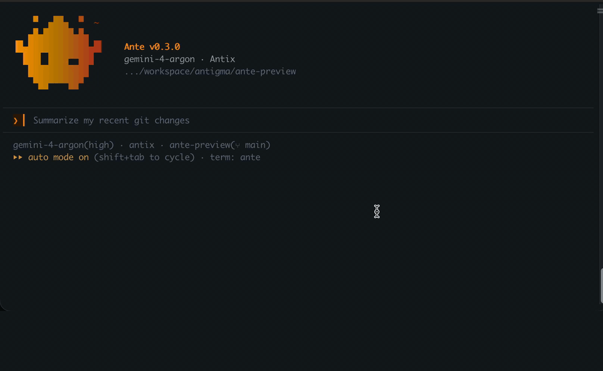
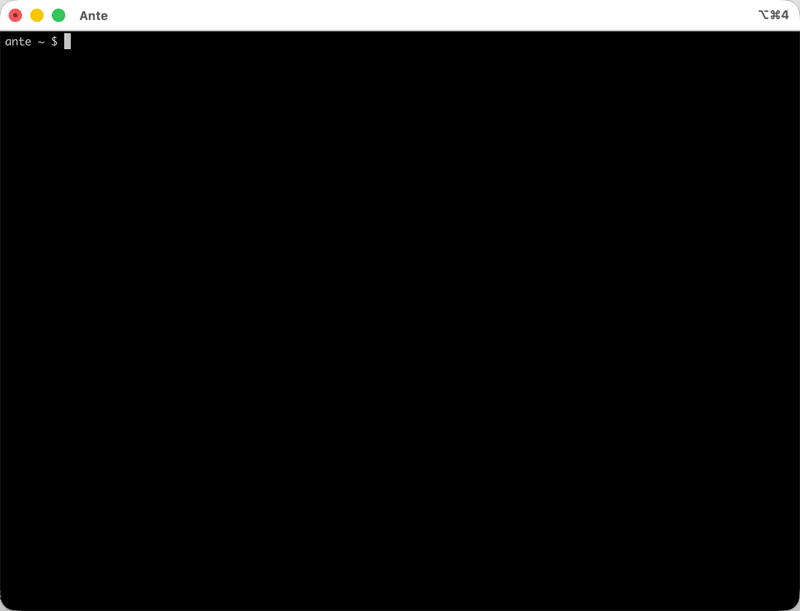
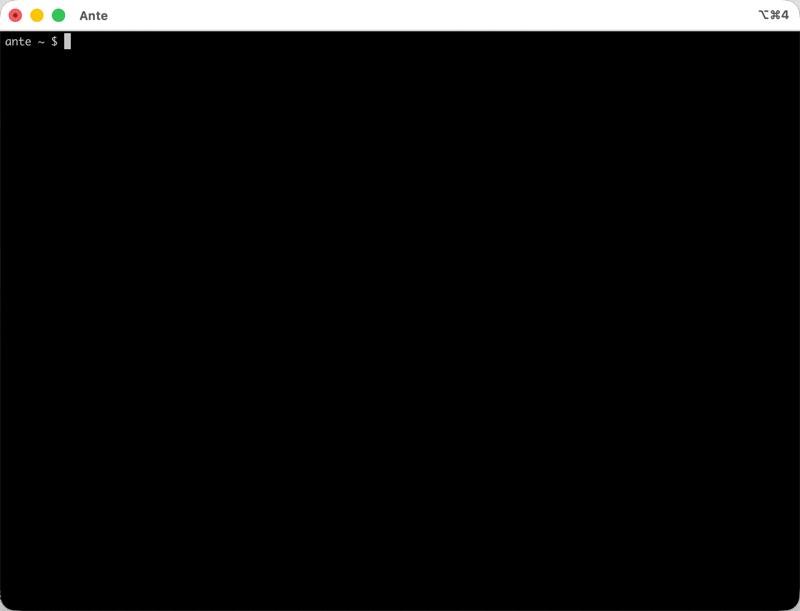

<p align="center">
  
</p>

<p align="center">
  <a href="https://github.com/AntigmaLabs/ante/releases"></a>
  <a href="https://antigma.ai/eval"></a>
  <a href="https://docs.antigma.ai"></a>
  <a href="https://discord.gg/CbAsUR434B"></a>
</p>

# Ante

**A ghost in your shell.** Ante is a self-contained coding agent that lives in your terminal and self-organizes. One ~15MB compressed download from [Antigma Labs](https://antigma.ai) that expands to a single Rust executable with zero runtime dependencies, built to get the most out of any model.

It keeps pace with frontier agents like Claude Code and Codex, with native local inference as a first-class citizen. It can also be the optimized core for [building your own harness](examples/mini-tui) and high-performing assistants.

```sh
curl -fsSL https://ante.run/install.sh | bash
ante
```

No API key? [Run it fully offline](#-native-local-inference) with a local model. Already using Claude Code or Codex? Give them the [Ante skill](curated/skills/ante) to hand work to Ante.

| 🥇 [Terminal-Bench 1.0 → 4.1](#-continuously-evaluated-and-evolved-in-public) | 🔌 [Native local inference](#-native-local-inference) | 🪶 [~7× less memory](#-a-fraction-of-the-footprint) |
|---|---|---|
| Benchmarked as shipped, at the frontier for more than a year | Context that adapts to smaller models | than Claude Code on the same 20 tasks |


We care about **the harness, not a co-trained model or a secret prompt**. The harness and the model are a dynamic duo: they should evolve together but not be bound together. Prompts belong to the user.

Ante makes this declarative: [one settings profile](#one-binary-many-agents) can define the whole agent, replacement system prompt included.

### 🥇 Continuously evaluated and evolved in public

**We keep up with the frontier so you don't have to.** We benchmark the build we ship: each result pins the exact release you can download and links the raw Harbor run for independent audit. For more than a year, we have run Ante through every new version of Terminal-Bench as it landed, and kept it at the frontier:

- **[Terminal-Bench 4.1](https://antigma.ai/eval)** (current): **65.6% with Gemini 4 Neon, beating Google's native Antigravity CLI on the same model** (61.2%). With DeepSeek V4.1 Flash 1017, 40.9% against the verified Claude Code row's 38.5%. Ante is the #1 same-model agent on both.
- **Terminal-Bench 2.1**: 83.9% with open-weight DeepSeek V4.1 Flash for about $18 of inference, edging past Fable 5 in its native Claude Code (83.8%, about $553).
- **Terminal-Bench 2.0** (early 2026): #1 verified agent.
- **Terminal-Bench 1.0** (2025): #1.

New models and harder benchmarks keep landing, and the Ante you install has already been measured against them. Every run keeps the benchmark's official timeouts and sandbox resource limits, the same standard the frontier labs' own agents follow. We evaluate Ante as a harness across model families. [Track record →](https://docs.antigma.ai/benchmarks/eval#track-record)

#### Same model, different harness

[](https://antigma.ai/blog/2026/08/04/harness-matter)

**[Live cross-model results →](https://antigma.ai/eval)** · [Same-model harness comparison →](https://antigma.ai/blog/2026/08/04/harness-matter) · [Methodology →](https://docs.antigma.ai/benchmarks/eval)

### 🔌 Native local inference

Local models are a first-class way to run Ante. They sit in the same catalog as hosted providers and run the same full prompt and tool stack.

- **Deep.** Ante installs and runs the inference engine itself, with a build matched to your hardware. It finds models on your disk, estimates memory before a load, and manages the server from the TUI.
- **Adaptive context.** The context window is sized to the memory you have. The skills list and compaction scale to that window, so the agent loop runs in a window as small as 32K.
- **Verified.** A curated model list is tested against Ante's agent loop for loading, chat templates, and tool calling.

Point Ante at a local model and the whole loop runs on your machine: no API key, no account, no internet.

```sh
ante --offline-model ~/.ante/models/Qwen3.5-9B-Q4_K_M.gguf \
  -p "add error handling to src/main.rs"
```

Set a reusable default with `ante offline use Qwen3.5-9B`, then launch it with `ante --offline-model` (interactive) or `ante --offline-model -p "your task"` (headless). Run `ante offline list` to see available models and `ante offline status` to inspect the engine. Verified models download on first load; install the engine with `ante offline install` before using the launch flag.

We think about the engine layer in public too. [**nanochat-rs**](https://github.com/AntigmaLabs/nanochat-rs) is a small GPT inference core we wrote in pure Rust on [candle](https://github.com/huggingface/candle): readable, runnable, and living in the same process as the code that calls it. It is a study project rather than part of the binary, published because in-process inference is where local models get interesting for agents.

**[Local models →](https://docs.antigma.ai/local/overview)** · [Offline mode →](https://docs.antigma.ai/local/offline) · [nanochat-rs →](https://github.com/AntigmaLabs/nanochat-rs) · [Where this is going →](https://docs.antigma.ai/experimental/agent-native-inference)

### 🪶 A fraction of the footprint

Ante is hand-written Rust: the heavy parts (`Grep`, `git`) are embedded in one binary and one process. Across the same 20 parallel tasks in Docker, Ante uses **~7× less peak memory**, **~9× less average CPU**, and **~5× less disk I/O** than Claude Code.


**[Raw numbers →](https://docs.antigma.ai/benchmarks/compare_table)** · [Benchmark details →](https://docs.antigma.ai/benchmarks/eval)

---

These three properties are one design decision. An agent you can **verify**, **run anywhere**, and **afford** is light enough to run by the *thousands*: the substrate for self-organizing intelligence.

## Orchestrate agents with `/term`

**Open an agent in a terminal. Let Ante drive it. Step in whenever you want.** `/term` gives you and Ante a shared view of another interactive session, so coordinating agents feels like working side by side in your terminal.

```text
/term ante
/term claude
/term codex
```

Each command opens a named terminal and launches the installed CLI when the session is new. Ask the main Ante to give another agent a task, read its progress, send follow-up prompts, or compare answers from several agents. You can watch and type in the same terminal at any time.

Use an agent's native fork command to **branch a saved conversation**, or ask Ante to hand the current task and findings to a fresh session. These terminals make useful **persistent, interactive subagents**: detach a viewer and the agent keeps running; restart Ante and reconnect to the same live session. Run `/term` to find your sessions, attach or detach, and stop them when you're done.

Requires `tmux` and whichever agent CLIs you want to run. [**Terminal orchestration walkthrough →**](https://docs.antigma.ai/usage/tui#terminal-sessions) · [Forking conversations →](https://docs.antigma.ai/usage/tui#fork-a-conversation)

## See it in action

<table>
<tr>
<td width="50%">

**[Providers, Credentials & Models](https://docs.antigma.ai/usage/providers)**



</td>
<td width="50%">

**[Providing Context: Files & Folders](https://docs.antigma.ai/usage/providing-context)**



</td>
</tr>
<tr>
<td width="50%">

**[Interrupting & Steering](https://docs.antigma.ai/usage/steering)**



</td>
<td width="50%">

**[Sub-Agents](https://docs.antigma.ai/extend/subagents#watch-sub-agents-work)**


</td>
</tr>
<tr>
<td width="50%">

**[Background Jobs](https://docs.antigma.ai/usage/tui#background-jobs)**


</td>
</tr>
</table>

[Walk through a task in the terminal](https://docs.antigma.ai/usage/tui)

## Quick Start

### Installation

Ante is a single, self-contained binary with no external dependencies: download and run. It supports macOS and Linux; on Windows, use [WSL](https://learn.microsoft.com/windows/wsl/install).

```sh
curl -fsSL https://ante.run/install.sh | bash

# Install a specific release channel
curl -fsSL https://ante.run/install.sh | bash -s -- nightly

# Install into a directory already on PATH
curl -fsSL https://ante.run/install.sh | ANTE_INSTALL_DIR=/usr/local/bin bash
```

The installer configures your shell's `PATH`. Open a new terminal to run `ante`, or start immediately with `~/.ante/bin/ante`.

### Start a session

Run `ante` from your project directory. If prompted, open `/providers` to sign in or paste an API key. Try asking, “Where does this project start, and which test covers that path?” Follow up in the same session to investigate a file or make a change. [Interactive guide](https://docs.antigma.ai/usage/tui)

### Modes

| Mode | Command | Use it for |
|------|---------|------------|
| [Interactive TUI](https://docs.antigma.ai/usage/tui) | `ante` | day-to-day work in the terminal (`--fullscreen` for alternate screen) |
| [Headless](https://docs.antigma.ai/usage/headless) | `ante -p "..."` | one-shot tasks, scripts, CI |
| [Server](https://docs.antigma.ai/usage/serve) | `ante serve` | editor plugins and integrations, over stdio, socket (`--sock`), or WebSocket |
| [Gateway](https://docs.antigma.ai/usage/gateway) | `ante gateway` | running Ante as a Slack or Discord bot (requires `ante-gateway`) |

### Headless examples

```sh
# Fix a bug
ante -p "find and fix the failing test in src/auth"

# Review a diff
git diff | ante -p "review this for security issues"

# Resume a saved session
ante --resume ses_01ARZ3NDEKTSV4RRFFQ69G5FAV -p "now add tests"

# Run fully offline with a local model
ante --offline-model ~/.ante/models/Qwen3.5-9B-Q4_K_M.gguf \
  -p "add error handling to src/main.rs"
```

### Update Ante

```sh
ante update

# One-off update from a different channel
ante update --channel nightly

# Roll back or pin to an exact release
ante update --version v0.3.9
```

## One binary, many agents

Ante's behavior lives in a settings file, and `--profile <name>` swaps that file per run: system prompt, tool set, skills, memory. The same binary can be a full assistant in one terminal and a minimal agent in the next.

For project-specific workflows, Ante loads `.ante/settings.json` from the nearest ancestor of the session directory, layering tool and skill filters, reasoning effort, and other supported session settings over user preferences. Project settings cannot change the provider or model, add MCP servers, or widen permissions.

Curated profiles demonstrate how flexible this is:
- [`pi`](curated/pi): Strips Ante down to four tools (Read, Write, Edit, Bash) and a [short replacement system prompt](curated/pi/pi.system-prompt.md); file search runs through `rg`, subagents through `ante -p "<task>"`, web access through `curl`.
- [`plan`](curated/plan): A read-only research and planning agent with file mutations disabled, designed to produce an implementation plan before you execute.

```sh
cp curated/pi/pi.settings.json ~/.ante/
ante --profile pi
```

A profile replaces the whole settings file, so anything it omits falls back to Ante defaults, and explicit CLI flags still win. Ante also ships a built-in `bare` profile for stripped-down runs: no skills, MCP servers, session saving, or auto-memory. Share what you build in [`curated/`](curated).

**[Named profiles →](https://docs.antigma.ai/configuration/profiles)** · [Project settings →](https://docs.antigma.ai/configuration/preference#project-settings) · [Curated profiles →](curated)

## What's in this repo

- **Applications:**
  - [`ante-acp`](ante-acp) — [Agent Client Protocol](https://agentclientprotocol.com) server driving Ante from editors like Zed and JetBrains IDEs.
- **Protocol & SDKs:**
  - [`crates/protocol-shape`](crates/protocol-shape) — Wire message schema spoken by `ante serve`.
  - [`crates/ante-sdk`](crates/ante-sdk) — Async Rust SDK for controlling Ante over stdio or Unix domain sockets.
- **Core Primitives:**
  - [`crates/exec`](crates/exec) — Bounded async process execution.
  - [`crates/llm`](crates/llm) — LLM provider profiles and shared primitives.
- **Evaluation:**
  - [`ante-harbor/`](ante-harbor) — Harbor agent adapter behind our [Terminal-Bench results](https://antigma.ai/eval).
- **Profiles & Docs:**
  - [`curated/`](curated) — Reusable settings profiles (such as [`pi`](curated/pi) and [`plan`](curated/plan)) and skills.
  - [`docs-site/`](docs-site) — Source for [docs.antigma.ai](https://docs.antigma.ai).
- **Examples** (built on the published [`ante-sdk`](https://crates.io/crates/ante-sdk)):
  - [`examples/mini-tui`](examples/mini-tui) — One-file chat TUI: a starting point for your own harness.
  - [`examples/ante-gateway`](examples/ante-gateway) — Slack and Discord gateway for Ante.

### Installing the applications

Install ACP and the gateway from crates.io:

```sh
cargo install ante-acp ante-gateway
```

To build from this checkout instead, use `cargo install --path ante-acp` or `cargo install --path examples/ante-gateway`.

Once installed on `PATH`, they can be invoked directly (`ante-acp`, `ante-gateway`) or dispatched via `ante`:

```sh
ante acp       # runs ante-acp
ante gateway   # runs ante-gateway
```

The protocol surface maps to Ante's client-daemon architecture:

```
┌─────────────────────────────────────────────────────────────┐
│                         Clients                             │
│                                                             │
│   ┌───────────┐    ┌───────────┐    ┌────────────────────┐  │
│   │    TUI    │    │ Headless  │    │    ante serve      │  │
│   │  (ante)   │    │ (ante -p) │    │   stdio/sock/ws    │  │
│   └─────┬─────┘    └─────┬─────┘    └─────────┬──────────┘  │
└─────────┼────────────────┼─────────────────────┼────────────┘
          │                │                     │
          ▼                ▼                     ▼
┌─────────────────────────────────────────────────────────────┐
│                         Daemon                              │
│                                                             │
│   Session ──▶ Turn ──▶ Step                                │
│                                                             │
│   ┌──────────┐  ┌──────────────┐  ┌───────────────────┐     │
│   │  Tools   │  │  Permission  │  │  Skills / Agents  │     │
│   └──────────┘  └──────────────┘  └───────────────────┘     │
└────────────────────────┬────────────────────────────────────┘
                         │
                         ▼
┌─────────────────────────────────────────────────────────────┐
│                     LLM Providers                           │
│                                                             │
│   Anthropic · OpenAI · Gemini · Grok · Open Router · Local  │
└─────────────────────────────────────────────────────────────┘
```

## The bigger picture

Ante is designed for **cellular-native** agents: like cells in an organism, tiny, expendable, massively replicated. That thesis is why the three headline claims exist. A cell-scale agent must be *verified* (reliability compounds at scale), *tiny* (every byte is multiplied by thousands), and *self-contained* (no runtime to install, no service to phone home to). Read more in our [philosophy](https://docs.antigma.ai/start/philosophy) and [agent organization patterns](https://docs.antigma.ai/experimental/agent-org).

## FAQ

### Why another terminal agent?

The name is the answer: **An**other **Te**rminal agent, and *ante*, the stake you put on the table to play. Ante is fast, lightweight, and the only terminal agent with native local inference built in. We believe a self-contained agent core that self-organizes is the foundation of the coming agent economy.

<details>
<summary><b>How is Ante different from other agents?</b></summary>

Ante has most of the features you expect from agents like Claude Code or Codex: multi-agents, skills, MCP, persistent memory. The difference is the build philosophy.

- Built from scratch in Rust: one executable that downloads as ~15MB compressed and unpacks to 34.1 MiB (the figure our [harness comparison](https://antigma.ai/blog/2026/08/04/harness-matter) tables report). Core components like `Grep` (fully rebuilt and customized) and `git` run in the same process, so nothing is shelled out and no resources leak. Most similar projects ship on Node.js or CPython and carry an order-of-magnitude larger footprint.
- Local inference is native: Ante runs the engine itself and fits its context to the model's window, so a local model is all it needs to run without any provider.
- No vendor lock-in, not even to ourselves: no account needed, reuse your existing API credentials. An opt-in, fully integrated server-side experience lives at [antix.antigma.ai](https://antix.antigma.ai).
- Every claim is backed by public, reproducible benchmarks of the exact builds we ship: [antigma.ai/eval](https://antigma.ai/eval).

Beyond the footprint it comes down to agent architecture, and ultimately to *who* is building it and with what philosophy. Anyone can fork a binary; taste and engineering rigor don't copy. Those differences leak into every detail of the product.

</details>

<details>
<summary><b>Why care about runtime optimization like memory and I/O if model inference is usually the biggest bottleneck?</b></summary>

For one-on-one agent interactions, runtime overhead like memory usage and I/O is often less important than model inference.

But our vision is much bigger: millions of agents self-organizing and communicating at massive scale. At that point, even small inefficiencies get multiplied millions or billions of times, so runtime optimization becomes economically significant.
</details>

<details>
<summary><b>Can I run Ante completely offline?</b></summary>

Yes. Ante has a built-in local inference engine. It handles engine installation, model discovery, and memory management automatically. No API keys or internet connection required.
</details>

<a id="supported-providers"></a>

<details>
<summary><b>Can I use my own custom models or providers?</b></summary>

Run `/add-provider` in the TUI to connect your endpoint, then choose it in `/providers`. For settings such as custom headers, see the [configuration examples](https://docs.antigma.ai/reference/catalog-reference#custom-catalog).
</details>

<details>
<summary><b>What is the <code>ante serve</code> mode for?</b></summary>

Server mode runs Ante as a long-lived daemon that communicates over a structured JSONL protocol. It's ideal for building editor plugins, web UIs, and custom integrations on top of Ante.
</details>

## Documentation

Full documentation is available at [docs.antigma.ai](https://docs.antigma.ai).

## License

Source code in this repository (including the SDK and protocol crates) is
licensed under the [Apache License 2.0](LICENSE).

The prebuilt `ante` binary is free to use, including commercially, under the
[Binary Preview Terms](BINARY-TERMS.md). The SDK
and protocol surface you build against here remain permissively licensed.

We are refactoring the agent and open-sourcing it piece by piece. Progress is
tracked in [#21](https://github.com/AntigmaLabs/ante/issues/21).
For now, the most useful contribution is a
[GitHub issue](https://github.com/AntigmaLabs/ante/issues/new/choose); see
[CONTRIBUTING.md](CONTRIBUTING.md).
